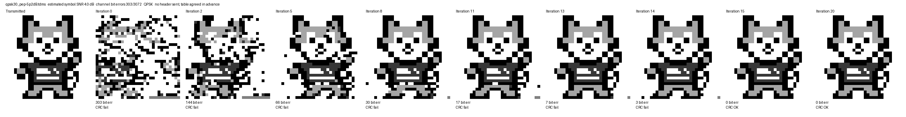

# LDPC photo link over a real ZCU111 RF channel

Supplementary demo for the NUS CEG5203 final project *LDPC Decoder Acceleration*.
A small grey-scale photo is Huffman-compressed, protected with the project's
QC-LDPC(384,194) code, sent from a ZCU111 RFSoC DAC through an SMA cable into its
ADC, and recovered on the PC. Lowering the DAC power produces real channel errors,
which the LDPC decoder removes iteration by iteration.



*Real capture, QPSK 30×30, DAC PEP −5.2 dBFS: 303 of 3072 coded bits wrong at the
receiver; the decoder removes them over 15 NMS iterations (CRC OK).*

## Pipeline

```
wolfram.png -> 20x20 / 30x30, 4 grey tones -> canonical Huffman + CRC-16
  -> LDPC(384,194) encode -> BPSK or QPSK, 407.04 MHz carrier -> TDMS
  -> ZCU111 DAC (Tile 1 DAC 3) -> SMA cable -> ADC (Tile 0 ADC 01), 4096 MSPS capture
  -> PC: band filter, preamble sync (timing + phase), soft symbols -> LLR
  -> NMS decoding (alpha 0.75, max 20 iterations) -> Huffman decode -> CRC -> image
```

The LDPC code tables (`ldpc_tables/`) are the same ones used by the team's FPGA
decoder and dataset; this encoder reproduces the dataset's codewords bit for bit.

## Results (real ADC captures, `captures/`)

| Capture | Modulation, image | DAC PEP | Est. SNR* | Channel bit errors | Errors after 20 it. | First CRC OK |
|---|---|---|---|---|---|---|
| `bpsk20_pep0dB` | BPSK, 20×20 | 0 dBFS | 10.6 dB | 0 / 1536 | 0 | iteration 0 |
| `bpsk20_pep-5dB` | BPSK, 20×20 | −5 dBFS | 6.3 dB | 31 / 1536 | 0 | 1 |
| `bpsk20_pep-7dB` | BPSK, 20×20 | −7 dBFS | 4.8 dB | 83 / 1536 | 0 | 3 |
| `qpsk30_pep-3dB` | QPSK, 30×30 | −3 dBFS | 5.0 dB | 172 / 3072 | 0 | 4 |
| `qpsk30_pep-5dB` | QPSK, 30×30 | −5 dBFS | 4.2 dB | 278 / 3072 | 0 | 9 |
| `qpsk30_pep-5p2dB` | QPSK, 30×30 | −5.2 dBFS | 4.0 dB | 303 / 3072 | 0 | **15** |
| `qpsk30_pep-5p3dB` | QPSK, 30×30 | −5.3 dBFS | 4.0 dB | 312 / 3072 | 27 | — (one codeword never converges) |
| `qpsk30_pep-7dB` | QPSK, 30×30 | −7 dBFS | 3.4 dB | 509 / 3072 | 445 | — |

\* Estimated from the soft symbols (BPSK: per symbol; QPSK: per I/Q component, i.e. per bit).

Per-iteration images and CSVs for every capture are in `results/<capture>/`.

Observations:

- The errors come from the real analog channel after lowering the DAC output power;
  no simulated noise is added anywhere.
- Near the LDPC threshold (QPSK around −5.2 to −5.3 dBFS) the outcome changes sharply:
  most codewords converge within ~10 iterations and the remaining one either converges
  or keeps oscillating. Four captures at −5.3 dBFS all left one or more codewords
  unconverged; the −5.2 dBFS capture shown above was selected from several captures
  in this region to illustrate a slow (15-iteration) convergence.
- Huffman is fragile: a single residual bit error shifts every later pixel, so the image
  is only exact once every codeword is corrected (checked with CRC-16).

## Repository layout

| Path | Content |
|---|---|
| `prepare_tx_bpsk.py` | Image → Huffman (with header) → LDPC → BPSK DAC waveform (`tx/bpsk_20x20/`) |
| `prepare_tx_qpsk.py` | Image → header-less Huffman → LDPC → QPSK DAC waveform (`tx/qpsk_30x30/`) |
| `rx_decode.py` | ADC capture → sync → LLR → NMS → image, with/without-LDPC comparison |
| `rx_iterations.py` | Decoded image and error counts for each iteration limit |
| `codec.py` | LDPC(384,194) encoder and float32 flooding NMS reference decoder |
| `huffman.py` | Canonical Huffman payload format, CRC-16, known-table decoding |
| `modem.py` | BPSK / QPSK symbol mapping and passband waveform |
| `ldpc_tables/` | Code tables shared with the FPGA decoder |
| `images/wolfram.png` | Source picture |
| `tx/` | Transmitted waveforms (`*_all_*.tdms`), `manifest.json`, `reference.npz` |
| `captures/` | Selected real ADC captures exported from the RF Data Converter Evaluation UI |
| `results/` | Iteration figures and CSVs generated from `captures/` |
| `docs/hardware_steps_zh.md` | Step-by-step board procedure (Chinese) |

## Quick start

```bash
pip install -r requirements.txt

# decode a capture and compare with / without LDPC (output in rx_results/)
python rx_decode.py captures/qpsk30_pep-5p2dB.tdms --tx tx/qpsk_30x30

# decoded image after 0, 2, 5, ... iterations
python rx_iterations.py captures/qpsk30_pep-5p2dB.tdms --tx tx/qpsk_30x30 --show 0 2 5 8 11 13 14 15 20

# regenerate the transmit waveforms (identical to the ones in tx/)
python prepare_tx_bpsk.py
python prepare_tx_qpsk.py
```

`reference.npz` holds what was transmitted; the receiver uses it only to count errors.
Decoding uses the received signal, the known 48-symbol preamble and, for the header-less
QPSK format, the Huffman table agreed in advance (`manifest.json`).

## Waveform design

Everything is sized for the RF Data Converter Evaluation UI in **BRAM** mode
(DDR mode corrupted even a single tone on our board):

| Item | Value |
|---|---|
| DAC | 6512.64 MSPS, real output, waveform ≤ 32,768 samples (64 KiB buffer) |
| ADC | 4096 MSPS, 16,384-sample capture |
| Carrier / symbol rate | 407.04 MHz / 407.04 MBd (16 DAC samples per symbol) |
| Length rule | multiple of lcm(159, 32) = 5088 samples: the UI requires multiples of 32, and FsDAC/FsADC = 159/100 makes the repeat period a whole number of ADC samples |
| Frame | 48-symbol preamble + data, 25,440 DAC samples = 16,000 ADC samples, repeated continuously |
| BPSK 20×20 | Huffman with header: 753 bits → 4 codewords → 1536 coded bits |
| QPSK 30×30 | Header-less Huffman: 1481 bits → 8 codewords → 3072 coded bits |

The 4 grey tones (0, 55, 165, 255) are those of the pixel-art source; each output pixel
takes the majority tone of its cell, and small isolated black features (eyes, nose) keep
one black pixel at their centroid.

## Limitations

- Decoding runs on the PC in Python (same code and algorithm as the FPGA decoder:
  flooding NMS, alpha 0.75, clip ±30, per-codeword early stop). It is not the FPGA.
- One demonstration image; results are single captures, and channel conditions vary
  by a few tenths of a dB between captures at the same DAC setting.
- Rectangular pulses, no pulse shaping; short SMA cable, no attenuator.

## Acknowledgements

Team: LIN KAI-CHIEH, XIONG BINZHI (NUS CEG5203). The LDPC code tables come from the
team's LDPC dataset generator. Parts of the code and documentation were written with
AI assistance (OpenAI Codex, Anthropic Claude) and checked against hardware captures.
